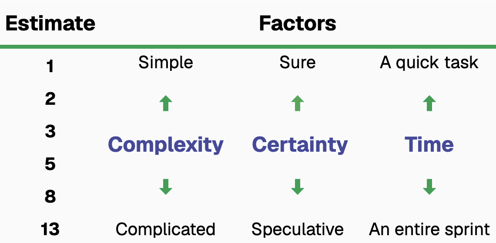
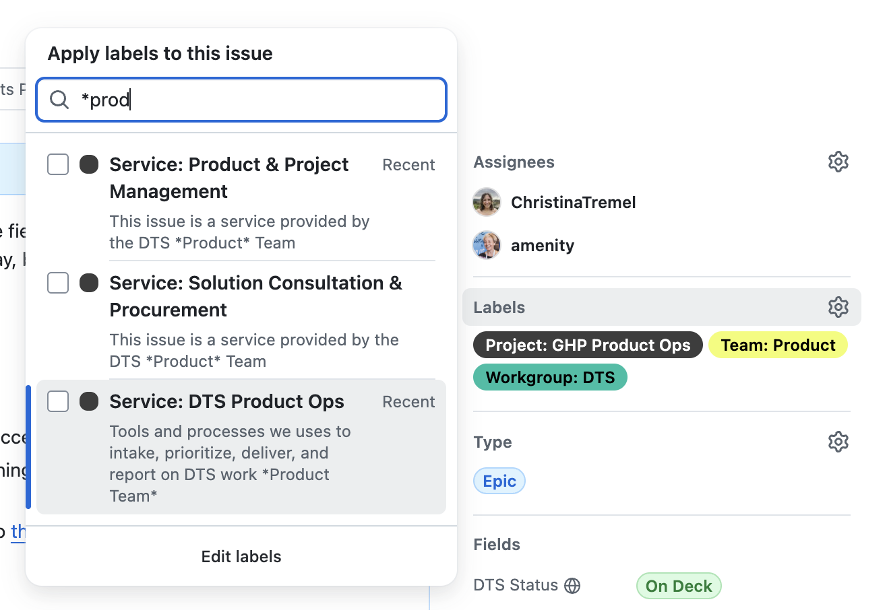

# Tracking work with GitHub issues

Data & Technology Services tracks all of our work as GitHub issues in the [atd-data-tech](https://github.com/cityofaustin/atd-data-tech) repository. We rely on a standardized system of labels, issue types, and issue fields to plan sprints, report on service delivery, and keep [Austinmobility.io](https://austinmobility.io) and the [DTS Portfolio](https://github.com/orgs/cityofaustin/projects/27) up to date.

## Creating an issue

With [a few exceptions](github-issues.md#type), you should use the ["DTS Issue" template](https://github.com/cityofaustin/atd-data-tech/issues/new?template=-+dts-issue.md) to create issues. It's the top option in the list of templates you see after clicking the green "New Issue" button in the upper right of the [GitHub _Issues_ page](https://github.com/cityofaustin/atd-data-tech/issues).&#x20;

<figure><figcaption></figcaption></figure>


Many people find it handy add a bookmark [the direct link](https://github.com/cityofaustin/atd-data-tech/issues/new?template=-%20dts-issue.md) to their browser bar so they can open new issues with one-click.&#x20;


## Title

Issue titles should begin with a verb and summarize the work: Update, Implement, Add, Remove, Review, Discuss, Troubleshoot… You don't need to spell out application names or issue types in the title; the fields and labels cover that.

| <h4><mark style="color:$primary;"><strong>Use this</strong></mark></h4> | <h4><mark style="color:$primary;"><strong>Not this</strong></mark></h4> |
| ----------------------------------------------------------------------- | ----------------------------------------------------------------------- |
| Add task order fields to "Funding" tab                                  | AMD staff can't track all funding information                           |
| Publish new CCTV camera thumbnails                                      | CCTV map issues                                                         |
| Replace VZE council district dataset                                    | Outdated council district AGOL resource in Vision Zero Editor           |

## Assignees

The person or people who will do the work. Oftentimes, issues are temporarily assigned to product managers or team leads while they are scoped and prioritized.&#x20;

## Type

The majority of your issues will be tasks. The other types are typically used by product managers and team leads.

| <h4><mark style="color:$primary;"><strong>Type</strong></mark></h4> | <h4><mark style="color:$primary;"><strong>Description</strong></mark></h4>                                                                                                                                                                              |
| ------------------------------------------------------------------- | ------------------------------------------------------------------------------------------------------------------------------------------------------------------------------------------------------------------------------------------------------- |
| Task                                                                | A specific piece of work. Can have sub-issues.                                                                                                                                                                                                          |
| Epic                                                                | A body of work bigger than a task but smaller than a project. See hen to use a task instead of a parent issue.                                                                                                                                          |
| Project                                                             | A substantial, time-boxed endeavor that spans multiple sprints, significantly improves TPW operations, or achieves a notable strategic outcome.                                                                                                         |
| Product                                                             | An application or digital system we build and support in-house, such as the [Finance & Purchasing Portal](https://austinmobility.io/products/2903) or the [Vision Zero Crash Data System](https://austinmobility.io/products/255).                      |
| Service                                                             | Ongoing consultation, training, or assistance to support the use of data and technology, such as [Geodata Quality Control](https://austinmobility.io/services/28553) or [Power BI Support](https://github.com/cityofaustin/atd-data-tech/issues/27373). |


### When do you use an _epic_ instead of a _task_ with subissues?

Epics and parent tasks are both useful for bundling issues into hierarchies for organizational purposes. Use an epic when you want to record a start date and end date so that the collection of work is visible in a GitHub projects roadmap view.&#x20;


## Fields

Issue fields appear under Fields in the issue's right-hand sidebar, and the set you see depends on the issue type. These are the fields that matter for a Task; everything else is covered in the table further down.

### DTS Status

Where the issue is in its life. Update it as you go; this single field drives every team board.

<table data-header-hidden data-search="false"><thead><tr><th></th><th></th></tr></thead><tbody><tr><td><h4><mark style="color:$primary;">Status</mark></h4></td><td><h4><mark style="color:$primary;">Definition</mark></h4></td></tr><tr><td>New</td><td>Awaiting triage by the Service Desk, team lead, or product manager</td></tr><tr><td>Needs Scoping</td><td>Ready for scoping and prioritization</td></tr><tr><td>Backlog</td><td>Scoped and prioritized</td></tr><tr><td>On Deck</td><td>Scheduled to begin this sprint</td></tr><tr><td>In Progress</td><td>Actively underway</td></tr><tr><td>Review/QA</td><td>Proposed as complete—pending teammate or stakeholder sign-off</td></tr><tr><td>Blocked</td><td>Cannot be worked on at this time</td></tr><tr><td>Ongoing</td><td>A continual service, product, or task—no projects, no epics</td></tr><tr><td>Icebox</td><td>Not under consideration at this time</td></tr><tr><td>Closed</td><td>Completed, or closed as not planned or duplicate</td></tr></tbody></table>


Closing an issue, by default, records it as something we completed. If it's closed for a different reason, you can click the caret on the "Close" button to note this:

 

If the work wasn't executed, make sure to delete the estimate from the issue so that we can keep our service delivery metrics accurate.


### DTS Team / DTS Teams

The DTS team doing the work: Apps, Data Science, Dev, ECM, Geo, Maximo, Product, Tech Services, or Operations. Setting it adds the issue to that team's board automatically. A Task can only be assigned to a single team. If two teams are working on the same thing, copy the issue so each team has its own that they can size according to the amount of effort they put in.&#x20;

### TPW Divisions

The primary division(s) served by this work. Use DTS for internal work and TPW for department-wide services and solutions. Every issue needs at least one division; add more only if the work truly serves several.&#x20;

### DTS Estimate

Estimates are how we track the level of effort of issues. Tasks should always have an estimate once pulled on deck or into progress, and estimates can be adjusted as needed. Check estimates for accuracy whenever you close an issue. Leave estimates blank for duplicates and other issues we decide not to undertake.

Estimates are also useful for

* Sprint planning — to see when a person or team has too many issues (or too few!) issues assigned to them
* Stakeholder discussions when prioritizing features — being able to show stakeholders easily that we can accomplish, say, three small tasks, two medium, or one large
* [Velocity tracking](https://www.zenhub.com/blog/track-your-speed-of-work-with-agile-velocity-charts/) — i.e. predicting the likelihood we can complete a project by a given date

<figure><figcaption></figcaption></figure>

_Curious why we use_ [_Fibonacci_](https://en.wikipedia.org/wiki/Fibonacci_sequence) _numbers for our estimates? Check out this_ [_lengthy explanation_](https://www.agilebin.com/blog/10-reasons-to-use-fibonacci-sequence-for-story-points)_._

## Labels

### Required Labels

**Every task needs a single `Service:` label.** You can pull up a list of your team's labels by typing an asterisk and then your team name, e.g. entering  `*apps` will pull up all the Apps Team `Service:` labels.

<figure><figcaption></figcaption></figure>

**If a Task or an Epic is part of a project, it needs that `Project:` label, and if the work is on a particular product, it needs that `Product:` label.**&#x20;

### Optional Labels

**`Need:`** — priority of a potential feature or enhancement

* 1-Must Have — No point in delivering a solution without this
* 2-Should Have — May be painful to leave out, but the solution is still viable
* 3-Could Have — Wanted, but affects fewer users or has less impact on business than other features
* 4-Won't Have — Will not be delivered at this time

**`Impact:`** — the effect of a bug or infrastructure failure

* 1-Severe — Severely impacts TPW service delivery
* 2-Major — Causes a major interruption of TPW service delivery
* 3-Minor — Deteriorates TPW service delivery
* 4-None — Does not affect TPW service delivery


Before migrating to GitHub Projects, we required **`Type:`** labels. They were often skipped, other times single issues were oftwn assigned multiple types, and usage wasn't consistent across teams. Despite efforts to refine the list and enforce standards, **`Type:`** labels never gave us data good enough to use for reporting.&#x20;

Now that we have [thoughtfully defined](https://github.com/cityofaustin/atd-data-tech/issues/26679) DTS "Services," that we incorporated [into our website](https://austinmobility.io/services) and executive communications, we dropped **`Type:`** labels from our standards in favor of **`Service:`** labels.&#x20;

