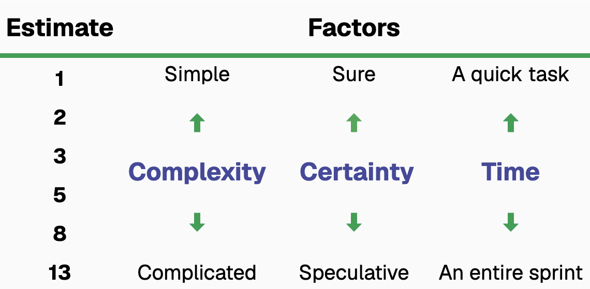

# Tracking work with GitHub issues

Data & Technology Services tracks all of our work as GitHub issues in the [atd-data-tech](https://github.com/cityofaustin/atd-data-tech) repository. We rely on a standardized system of labels, issue types, and issue fields to plan sprints, report on service delivery, and keep [Austinmobility.io](https://austinmobility.io) and the [DTS Portfolio](https://github.com/orgs/cityofaustin/projects/27) up to date.

## Creating an issue

With a few exceptions, you should always use the ["DTS Issue" template](https://github.com/cityofaustin/atd-data-tech/issues/new?template=-+dts-issue.md) to create issues. It's the first option in the list of templates you see after clicking the green "New Issue" button in the upper righthand corner of the [GitHub _Issues_ page](https://github.com/cityofaustin/atd-data-tech/issues).&#x20;

<figure><figcaption></figcaption></figure>


Many people find it handy add a bookmark [the direct link](https://github.com/cityofaustin/atd-data-tech/issues/new?template=-%20dts-issue.md) to their browser bar so they can open new issues with one-click.&#x20;


## Title

Issue titles for tasks should begin with a verb and summarize the work: Update, Implement, Add, Remove, Review, Discuss, Troubleshoot… You don't need to spell out application names or issue types in the title; the fields and labels cover that.

| Use this                               | Not this                                                      |
| -------------------------------------- | ------------------------------------------------------------- |
| Add task order fields to "Funding" tab | AMD staff can't track all funding information                 |
| Publish new CCTV camera thumbnails     | CCTV map issues                                               |
| Replace VZE council district dataset   | Outdated council district AGOL resource in Vision Zero Editor |

## Assignee

The person or people who will do the work. Oftentimes, issues are temporarily assigned to product managers or team leads while they are scoped and prioritized.&#x20;

<figure><figcaption></figcaption></figure>

## Type

Unless you are a product manager or team lead, you'll stick to the `Task` issue type. [Our other issue types](https://app.gitbook.com/o/-LzDQOVGhTudbKRDGpUA/sites/site_gQ0uW/s/-LzDGg7hKQ_fUjXnzGGx/~/edit/~/changes/361/product-ops/github-issues/issue-types-and-issue-fields#issue-types) are used for website content, reporting, and project planning.&#x20;

<figure><figcaption></figcaption></figure>

## Fields&#x20;

Fill out all issue fields according to the instructions below.&#x20;

<figure><figcaption></figcaption></figure>

#### DTS Status

Where the issue is in its life. Update it as you go; this single field drives every team board.

<table data-search="false"><thead><tr><th>Status</th><th>Definition</th></tr></thead><tbody><tr><td>New</td><td>Awaiting triage by the Service Desk, team lead, or product manager</td></tr><tr><td>Needs Scoping</td><td>Ready for scoping and prioritization</td></tr><tr><td>Backlog</td><td>Scoped and prioritized</td></tr><tr><td>On Deck</td><td>Scheduled to begin this sprint</td></tr><tr><td>In Progress</td><td>Actively underway</td></tr><tr><td>Review/QA</td><td>Proposed as complete—pending teammate or stakeholder sign-off</td></tr><tr><td>Blocked</td><td>Cannot be worked on at this time</td></tr><tr><td>Ongoing</td><td>A continual service, product, or task—no projects, no epics</td></tr><tr><td>Icebox</td><td>Not under consideration at this time</td></tr><tr><td>Closed</td><td>Completed, or closed as not planned or duplicate</td></tr></tbody></table>


Closing an issue, by default, records it as something we completed. If it's closed for a different reason, you can click the caret on the "Close" button to note this:

 

If the **work wasn't executed**, make sure to **delete the estimate** from the issue so that we can keep our service delivery metrics accurate.


#### DTS Team

The DTS team doing the work: Apps, Data Science, Dev, ECM, Geo, Maximo, Product, Tech Services, or Operations. Selecting a DTS Team on a task's issue field adds the issue to that team's project. A task can only be assigned to a single team. If two teams are working on the same thing, copy the issue so each team has its own that they can size according to the amount of effort they put in.&#x20;


### **Why does my issue have two&#x20;**_**DTS Team**_**&#x20;fields?**&#x20;

Projects and epics can be assigned to multiple DTS teams, whereas tasks, products, and services are limited to a single team. If you convert an issue from project/epic to another issue type, or vice versa, after filling out the teams field, you'll see both `DTS Team` and `DTS Teams` fields. Delete the value for the field that no longer applies and refresh the page to resolve the redundant information.&#x20;

 



#### TPW Divisions

The primary division(s) served by this work. Use DTS for internal work and TPW for department-wide services and solutions. Every issue needs at least one division; add more only if the work truly serves several.&#x20;

#### DTS Estimate

Estimates are how we track the level of effort of issues. Tasks should always have an estimate once pulled on deck or into progress, and estimates can be adjusted as needed. Check estimates for accuracy whenever you close an issue. Leave estimates blank for duplicates and other issues we decide not to undertake.

Estimates are also useful for

* Sprint planning — see when a person or team has too many (or too few!) issues assigned to them
* Stakeholder discussions when prioritizing features — easily show stakeholders that we can accomplish, in a coming sprint, e.g. five `1`-sized issues, a `2`-sized issue and a `3`-sized issue, _or_ a single `5`-sized issue
* [Velocity tracking](https://www.zenhub.com/blog/track-your-speed-of-work-with-agile-velocity-charts/) — identifying the speed the team typically delivers work, useful to determine when a set of work will be completed

<figure><figcaption></figcaption></figure>

_Curious why we use_ [_Fibonacci_](https://en.wikipedia.org/wiki/Fibonacci_sequence) _numbers for our estimates? Check out this_ [_lengthy explanation_](https://www.agilebin.com/blog/10-reasons-to-use-fibonacci-sequence-for-story-points)_._

## Labels

We use the following labels for tasks.&#x20;

### Service - _required_

Tasks require a single `Service:` label. You can pull up a list of your team's labels by typing an asterisk and then your team name, e.g. entering  `*apps` will pull up all the Apps Team `Service:` labels.



### Project and Product - _when applicable_

If a task is part of a project, apply that `Project:` label, and if the work is on a particular product, it needs that `Product:` label.&#x20;

### Impact or Need -  _optional_

The `Need:` and `Impact:` labels may be useful for triage and prioritization.&#x20;

Use `Impact:` to indicate the effect of a bug or infrastructure failure

* 1-Severe — Severely impacts TPW service delivery
* 2-Major — Causes a major interruption of TPW service delivery
* 3-Minor — Deteriorates TPW service delivery
* 4-None — Does not affect TPW service delivery

Use `Need:` to prioritize a potential feature or enhancement

* 1-Must Have — No point in delivering a solution without this
* 2-Should Have — May be painful to leave out, but the solution is still viable
* 3-Could Have — Wanted, but affects fewer users or has less impact on business than other features
* 4-Won't Have — Will not be delivered at this time

### Type

For the most part, `Service:` labels replace the `Type:` labels we used for many years. Services are carefully defined and team-specific, which makes them easier to use consistently to maintain good quality service delivery data. There are a few cases, however, where teams use `Type:` labels to further narrow their data for analysis. For example, `Service: Technology Procurement` has `Type: Hardware` so that Tech Services can meet their reporting needs.

## Projects

[Each DTS team has a dedicated GitHub project](https://github.com/cityofaustin/atd-data-tech/projects) (GHP), and tasks are automatically associated to a project when the `DTS Team` field is filled out.&#x20;

Issues can be added to other projects if it's useful. For example, an Apps Team project might have a few tasks assigned to the Geo Team and want to see track those in the Apps Team GHP since that's where they're doing their sprint planning. Issue fields will be synchronized across GHPs.&#x20;

<figure><figcaption>
An issue can be added to multiple GHPs.
</figcaption></figure>

#### Project fields

Teams can track information outside the organization-wide issue fields using GHP-specific project fields. These are visible when you expand the project's accordion in the sidebar.&#x20;

<figure><figcaption></figcaption></figure>


### **Why is are there GHP&#x20;**_**Status**_**&#x20;fields in addition to the&#x20;**_**DTS Status**_**&#x20;issue field?**&#x20;

Right?! We [aren't able to hide](https://github.com/orgs/community/discussions/189141#discussioncomment-17985459) the redundant `Status` field. You can leave the field empty, it has no impact anywhere.&#x20;

